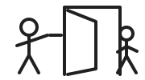

# Chinese pre-A1 project mock — form 2 (learner paper)

This independent form is an original, project-defined HSK precursor, **not an
official HSK paper**. English is the declared pre-A1 directions language.
Standard Mandarin and simplified characters are assessed. Reading (5 minutes),
listening (5), and writing (10) run continuously; speaking takes 5 minutes
after 1 minute of preparation. The complete mock is not a book lesson; every
lesson remains at most five minutes. Each skill has 25 points. Pass only with
**15/25 in every skill and 60/100 overall** in one sitting, with all sections
attempted. No dictionary, translator, pinyin input aid, model, or answer bank.

## Reading — 5 minutes, 25 points

<!-- mock-part:prea1-reading-pinyin-signs-and-doorway-words -->
Circle one meaning for each taught character or word. Each item is 5 points.
Pinyin is printed only in item 3, where pinyin recognition is the assessed act.

1. **我**: (a) please · (b) I · (c) you
2. **不**: (a) good · (b) name · (c) not / no
3. **zǎoshang hǎo**: (a) good morning · (b) goodbye · (c) thank you
4. **谢谢**: (a) what · (b) thank you · (c) after you
5. **名字**: (a) name · (b) character · (c) morning
<!-- /mock-part:prea1-reading-pinyin-signs-and-doorway-words -->

## Listening — 5 minutes, 25 points

<!-- mock-part:prea1-listening-tones-and-doorway-turns -->
Each short recording plays **twice**. Circle one answer, 5 points each. Only
the examiner holds the recording script.

6. Which syllable did you hear? (a) mà · (b) mǎ · (c) mā
7. Which meaning did you hear? (a) thank you · (b) goodbye · (c) good morning
8. You hear thanks. Which reply fits? (a) 不谢 · (b) 再见 · (c) 什么
9. Which picture matches? (a) a person pointing to themself · (b) a person
   writing · (c) two people saying goodbye
10. You hear that someone did not catch a word. Which meaning fits?
    (a) after you · (b) what? · (c) I am
<!-- /mock-part:prea1-listening-tones-and-doorway-turns -->

## Writing — 10 minutes, 25 points

Write by hand. No tracing guide or visible model during a response.

<!-- mock-part:prea1-writing-delayed-character-recall -->
11. The examiner shows one taught character for ten seconds, then covers it.
    Write that character from memory. (5 points)

    ____________________
<!-- /mock-part:prea1-writing-delayed-character-recall -->

<!-- mock-part:prea1-writing-dictation-and-transcription -->
Hear each item twice. For 12 write pinyin with its tone mark; for 13 write the
simplified character. (5 points each)

12. Pinyin: ____________________
13. Character: ____________________
<!-- /mock-part:prea1-writing-dictation-and-transcription -->

<!-- mock-part:prea1-writing-bounded-production -->
Use a known Chinese word or short chunk for each picture cue; no copyable
Chinese model is shown. (5 points each)

14.  ____________________
15.  ____________________
<!-- /mock-part:prea1-writing-bounded-production -->

## Speaking — 5 minutes, 25 points

<!-- mock-part:prea1-speaking-tone-and-doorway-exchange -->
The examiner speaks each prompt once; you may request **one slow repeat**.
Give one short turn, no longer than 15 seconds. Each item is 5 points. Do not
read a prepared script aloud.

16. The examiner says good morning. Reply in Mandarin.
17. The examiner says “请” at a doorway. Give the taught thanks.
18. The examiner says in English, “Please say who you are.” Say **I am** and
    your own name in Mandarin; your name may remain in its own language.
19. The examiner says goodbye. Reply in Mandarin.
20. The examiner says a taught fourth-tone syllable. Repeat its tone clearly.
<!-- /mock-part:prea1-speaking-tone-and-doorway-exchange -->

*End of form 2. The examiner scores against this form's separate rubric and key.*
