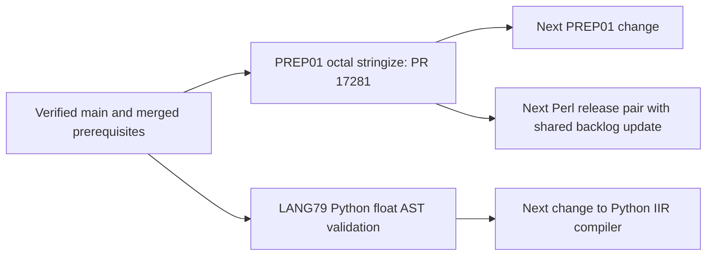

# LANG VM parallel work DAG

This scheduling contract follows the user’s 2026-10-11 instruction to alternate
streams and permit a second implementation PR for independent work. Separate
worktrees and branches protect unrelated edits. A shared read-only dependency
does not create a write conflict; changing that dependency does.

| Node | depends_on | Owned writes | Read-only dependencies |
| --- | --- | --- | --- |
| PREP01 octal / PR 17281 | merged decimal/hex stringize | c-to-semantic-ir dialect/tests/README/CHANGELOG, PREP01 spec, LANG VM backlog, three named lesson shards in its diff | source-preprocessor, C frontend, Semantic IR |
| Python float AST validation | merged Python arithmetic guards / PR 17256 | python-iir-compiler src/lib.rs/README/CHANGELOG, LANG79 spec, this DAG, unique lesson shards | Python 3.12 grammar, python-parser, lexer, interpreter-ir, vm-core |
| Next PREP01 | PR 17281 merged | PREP01 files currently owned above | chosen after fetch |
| Next Perl release | PR 17281 merged if updating shared backlog | perl-parser, release-specific token/grammar pair, LANG82 spec/inventory, shared backlog | own pinned release archive |
| Next Python implementation | Python float AST validation merged | python-iir-compiler and LANG79 spec | chosen after fetch |

The two initial implementation nodes have no edge between them and may publish
in parallel. The Python node does not edit the shared backlog, shared Rust
workspace/dependency manifests, lexer/parser grammars or generated files.
Maintain live PR numbers, exact heads, worktree paths and gate state in the
heartbeat checkpoint rather than editing this document from every branch.

Before publication, fetch main and audit the complete write sets of every
open PR. Require an empty intersection and no unmet semantic prerequisite;
otherwise add the dependency edge and defer the conflicting node. Recheck
after merges or changed heads. Serialize scheduling-document edits too.
For each PR independently: specs first, regression first, focused validation,
exact-final-head security review, all latest-head workflows and required gates,
conflict-free exact-head merge, fetched-main proof and clean worktree archive.
CI waiting on one node is time to advance another eligible node. Never infer
success from a missing, queued or superseded check, and never cancel another
stream’s workflows to make room.
