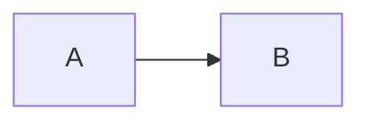

# TE04 — GFM Extensions

## Overview

TE04 extends the CommonMark / Document AST stack with GitHub Flavored Markdown
features that are not part of baseline CommonMark but are important in real
documents and applications.

The currently relevant GFM additions are:

- strikethrough
- task list items
- pipe tables
- a **general fenced block primitive**

That last item is the important architectural addition in this spec.

Historically, fenced blocks in the repo have been normalized immediately into
`CodeBlockNode { language, value }`. That is fine for syntax-highlighted code,
but it collapses several future uses into one rendering choice too early:

- Mermaid
- Graphviz / DOT
- fenced admonitions
- fenced chart DSLs
- fenced UI/layout snippets
- any future block whose payload is not "just code"

TE04 therefore adds a GFM-specific node that preserves the generic fenced-block
shape long enough for downstream transforms to decide what it means.

---

## New Node Types

TE04 adds these GFM node types:

```typescript
interface TableNode {
  readonly type: "table";
  readonly align: readonly ("left" | "right" | "center" | null)[];
  readonly children: readonly TableRowNode[];
}

interface TableRowNode {
  readonly type: "table_row";
  readonly isHeader: boolean;
  readonly children: readonly TableCellNode[];
}

interface TableCellNode {
  readonly type: "table_cell";
  readonly children: readonly InlineNode[];
}

interface StrikethroughNode {
  readonly type: "strikethrough";
  readonly children: readonly InlineNode[];
}

interface TaskItemNode {
  readonly type: "task_item";
  readonly checked: boolean;
  readonly children: readonly BlockNode[];
}

interface FencedBlockNode {
  readonly type: "fenced_block";
  readonly name: string | null;
  readonly info: string | null;
  readonly value: string;
}
```

---

## `FencedBlockNode`

### Purpose

`FencedBlockNode` is a **source-preserving GFM extension node**.

It represents:

- a fenced block opener/closer from Markdown
- its normalized info string
- its raw inner payload

without prematurely deciding that the payload must be rendered as code.

This is a GFM concern, not a core document concern, which is why it lives in
TE04 rather than TE00.

### Fields

```typescript
interface FencedBlockNode {
  readonly type: "fenced_block";

  // First whitespace-delimited token of the info string.
  // Examples:
  //   ```mermaid        -> "mermaid"
  //   ```typescript     -> "typescript"
  //   ```               -> null
  readonly name: string | null;

  // Entire normalized info string after the opening fence, or null if absent.
  // Examples:
  //   ```mermaid
  //   -> "mermaid"
  //
  //   ```mermaid theme=dark
  //   -> "mermaid theme=dark"
  readonly info: string | null;

  // Raw block payload, including the trailing newline when the block is non-empty.
  readonly value: string;
}
```

### Why both `name` and `info`?

Because downstream consumers typically need two different views:

- a cheap dispatch key, such as `"mermaid"` or `"typescript"`
- the untouched remaining info payload for block-specific parsing

`name` is the fast routing key.
`info` is the source-preserving metadata string.

### Why not just overload `CodeBlockNode.language`?

Because `language` implies a rendering decision:

> "This block is code, and the string is a syntax-highlighting hint."

That is true for many fences, but not for all fences we want to support.

`FencedBlockNode` preserves the more general truth:

> "This is a fenced block. A later phase decides whether it is code,
> a diagram, an admonition, a chart, or something else."

---

## Parsing Rules

### Block recognition

TE04 reuses the CommonMark fenced-block opening and closing rules:

- backtick fences and tilde fences are both valid
- opening fence indentation rules are unchanged
- closing fence rules are unchanged
- payload indentation stripping rules are unchanged

This spec changes the **AST shape**, not the line-level parsing rules.

### Mapping to `FencedBlockNode`

For a fenced block:

1. Parse the opening fence exactly as CommonMark already does.
2. Extract the full normalized info string.
3. Set `name` to the first whitespace-delimited token of that info string.
4. Set `info` to the full normalized info string, or `null` if absent.
5. Set `value` to the raw payload, preserving the current code-block newline rules.

Examples:

````markdown

````

becomes:

```typescript
{
  type: "fenced_block",
  name: "mermaid",
  info: "mermaid",
  value: "flowchart LR\n  A --> B\n",
}
```

````markdown
```typescript linenos
const x = 1;
```
````

becomes:

```typescript
{
  type: "fenced_block",
  name: "typescript",
  info: "typescript linenos",
  value: "const x = 1;\n",
}
```

````markdown
```
plain fenced text
```
````

becomes:

```typescript
{
  type: "fenced_block",
  name: null,
  info: null,
  value: "plain fenced text\n",
}
```

### Indented code blocks

Indented code blocks are **not** `FencedBlockNode`.

They remain `CodeBlockNode`, because they carry no GFM fence metadata and have
no extension-dispatch role.

That distinction is intentional:

- `CodeBlockNode` = normalized literal/preformatted content
- `FencedBlockNode` = source-level fenced construct awaiting interpretation

---

## Consumer Contract

### Default rendering behavior

Renderers and layout bridges that do not know any special fenced-block names
should still behave sensibly.

The default fallback for `FencedBlockNode` is:

- render it visually like a code block
- use `name` as a syntax-highlighting hint when applicable

So a generic HTML renderer may treat:

```typescript
{ type: "fenced_block", name: "typescript", value: "const x = 1;\n" }
```

the same way it would have treated:

```typescript
{ type: "code_block", language: "typescript", value: "const x = 1;\n" }
```

This gives us a clean extension seam **without regressing default behavior**.

### Specialized transforms

A transform package may match on `FencedBlockNode.name` and replace the node
with a richer representation.

Examples:

- `name === "mermaid"` -> parse diagram and replace with a diagram-aware block
- `name === "admonition"` -> replace with callout/admonition structure
- `name === "math"` -> replace with a math block node

This is the main architectural value of the primitive.

---

## Relationship to TE00 `CodeBlockNode`

TE00 `CodeBlockNode` remains correct and necessary.

It is still the right normalized node for:

- indented code blocks
- non-Markdown frontends that directly produce literal preformatted blocks
- post-transform fenced blocks that are still best rendered as code

The relationship is:

```text
Markdown fenced block
  -> FencedBlockNode        (TE04, source-preserving)
  -> optional transform
     -> CodeBlockNode       (if interpreted as ordinary code)
     -> Diagram block       (future)
     -> Other extension     (future)

Indented code block / non-Markdown literal block
  -> CodeBlockNode directly
```

---

## Package Implications

### `gfm-parser`

`gfm-parser` should preserve fenced blocks as `FencedBlockNode` instead of
eagerly collapsing them to `CodeBlockNode`.

### `gfm`

The convenience package may continue to provide code-block-like default output,
but it should do that as a **consumer behavior**, not by removing the
`FencedBlockNode` seam from the parsed AST.

### `document-ast-to-html`

Should provide a default fallback that renders unknown `fenced_block` nodes as
`<pre><code>…</code></pre>`.

### `document-ast-to-layout`

Should provide a default fallback that renders unknown `fenced_block` nodes as
monospace preformatted blocks, matching the current visual behavior of
`code_block`.

This keeps existing markdown rendering sane while making richer transforms
possible.

---

## Acceptance Criteria

TE04 is complete when:

1. GFM parsers preserve fenced blocks as `FencedBlockNode`.
2. `name` and full `info` are both preserved.
3. Indented code blocks remain `CodeBlockNode`.
4. HTML and layout consumers have a code-block fallback for unknown fenced blocks.
5. A downstream transform can distinguish ordinary fenced code from
   non-code fenced blocks without reparsing Markdown source.

That gives the repo a general-purpose fence seam for Mermaid and for future
fenced block features beyond diagrams.

## TypeScript fenced-node contract (October 2026 repair)

The public TypeScript GFM parser emits `FencedBlockNode` for every recognized
fence, including anonymous and empty fences. Indented code and existing
CommonMark/AsciiDoc producers retain `CodeBlockNode`; its discriminator and
`language` API do not change. Consumers accept both variants. This is an
intentional GFM AST correction: callers discriminating on `code_block` must
handle `fenced_block` as well.

Info normalization is deterministic: remove the opening fence, trim leading
and trailing ECMAScript whitespace, apply Markdown ASCII-punctuation backslash
escapes, then decode HTML character references once, then trim the decoded
result. Preserve interior whitespace and all remaining info text verbatim.
An empty result yields `info: null, name: null`; otherwise `info` holds that
entire result and `name` is its first ECMAScript-whitespace-delimited token.
This explicitly fixes decoded whitespace as a token boundary; it does not
collapse interior whitespace or recursively decode entities. Fence recognition,
indent removal and line-ending normalization remain CommonMark 0.31.2 rules.
`value` is literal payload with a final LF when nonempty, and the empty string
when no payload lines exist. No info text is interpreted as executable options.

HTML uses `name` as the escaped `language-` class hint and escapes `value`;
`info` is metadata and is never interpolated into HTML. Layout uses exactly
the existing preformatted monospace code fallback. AST sanitization applies
`dropCodeBlocks` to both variants and otherwise preserves fence fields.
Forme decoration/highlighting may perform their existing explicit filename and
span transforms, while retaining the fenced discriminator and metadata.
Typography, links and heading transforms treat payload as opaque. Static
style projection models `pre > code`; terminal and authoring import validate
exact canonical fields using their existing bounded snapshot policies. Fence
`name` and `info` are nullable strings, not legacy portable language names.
Authoring edits retain the full info string and recompute its first-token name;
empty fenced payload remains valid.

The parser continues to accept strings under its existing resource/error
contract. This repair introduces no arbitrary-size, hostile-input, plugin or
execution guarantee. Terminal/authoring limits remain their existing explicit
limits; no limit is removed to accommodate fences. Unknown named fences use
the inert code fallback. The full cross-language GFM corpus and language ports
remain separately owned.

Validation uses independent literal AST and hand-built consumer witnesses,
including distinct full info with identical language and HTML, anonymous/tilde/
empty/CRLF/indented/escape/entity/closing-fence cases. Preserve all 652 literal
CommonMark corpus expectations and skips. Run changed package tests and
production coverage, real build fronts, public consumer typechecks and reverse
consumer tests, then metadata/parity/diff/security checks. Commit this contract
before RED tests, then source, then package changelogs/README metadata.

Reference: [CommonMark 0.31.2 fenced code blocks](https://spec.commonmark.org/0.31.2/#fenced-code-blocks).
CommonMark permits implementation-specific info treatment; this section fixes
the additional TE04 metadata normalization contract.

### Fenced repair fixture CI selection

An exact repository-relative change to
`code/specs/gfm-fenced-block-v1/cases.json` selects the actual
`typescript/gfm-parser` reader for `all` and `typescript` lanes. Use both the
canonical package name and language; a missing or mismatched reader fails
closed before publishing a build plan. Other language filters ignore this
TypeScript component fixture. Selection unions with ordinary package edits;
normal dependency propagation includes its real consumers.

Do not stat the fixture: deletion and rename-old paths must still select its
reader. Near paths, alternate case, nested files and backslash lookalikes do
not qualify as this exact fixture. Preserve nil versus empty changed-file
inputs, `Force=false`, platform-specific selection for Linux/macOS/Windows,
required TypeScript toolchain detection and atomic plan publication: failure
must neither create nor replace an output file. The forced main build is not
evidence of fixture-only routing.
